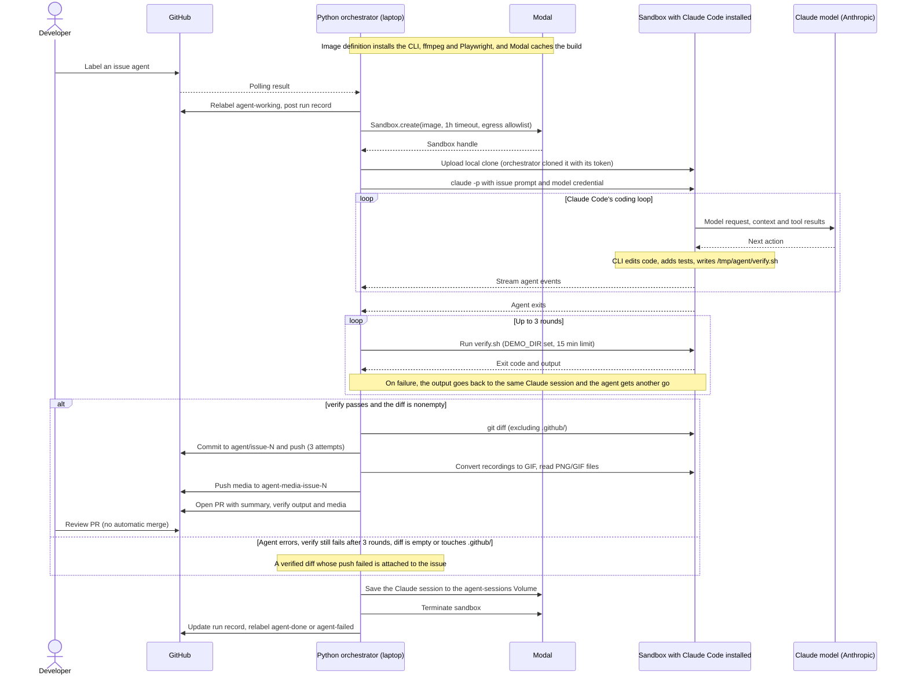

# Architecture: GitHub issue to pull request

**The Python program manages jobs. Claude Code manages the coding loop inside each job's sandbox.**

## Laptop polling and dispatch workflow

The orchestrator runs on your laptop (or any machine) with `python agent/run.py --watch`.
Every minute it asks GitHub which repos its token can push to; every five seconds it checks those
repos for open issues labelled `agent`, and every twenty seconds for `/agent` comments. Each new
issue gets a fresh Modal sandbox, and polling continues while jobs run concurrently. After Claude Code
finishes, the orchestrator verifies the work in the same sandbox, pulls the diff out, and publishes the
branch and PR from your laptop. Every sandbox is terminated when its run ends, whatever the outcome.

Download [the interactive workflow diagram](laptop-workflow.html) and open it locally,
or use [the slide-ready SVG](laptop-workflow.svg).

## Component architecture

## Build once, reuse per issue

`agent/run.py` defines a Modal image with Python, Git, curl, ffmpeg, Playwright with Chromium and the Claude Code CLI;
the agent installs the target repo's dependencies itself. Modal builds and caches that image. No credentials
are baked into it. Each issue gets a fresh sandbox created from the image.

The target repository is **cloned per issue** by the orchestrator, with its GitHub token, and
uploaded into the sandbox; it is not baked into this image, and private repos work. The separate
Act 2 snapshot demo illustrates filesystem snapshots, but the issue agent does not
currently boot from a repository snapshot.

## Per-issue sequence

## Responsibilities and credentials

| Component | Runs where | Responsibility | Credentials |
|---|---|---|---|
| Python orchestrator | Your laptop | Claim issue, create sandbox, start agent, run `verify.sh`, extract diff, publish PR and media, record the run, terminate the sandbox | GitHub and Modal credentials; supplies model credential to the agent process |
| Claude Code CLI | Inside the Modal sandbox | Read and edit repository files, add tests, write `verify.sh`, iterate with the model | `CLAUDE_CODE_OAUTH_TOKEN` (subscription), or `ANTHROPIC_API_KEY` |
| Claude model | Anthropic's servers | Reason over context and choose the CLI's next action | Receives authenticated model requests |
| Modal | Modal infrastructure | Build/cache image, provide isolation, execute commands, enforce the egress allowlist and 1-hour lifetime, keep saved sessions in a Volume | Orchestrator authenticates with Modal token |

The sandbox does not receive the GitHub or Modal token. The model credential is
injected via `modal.Secret` into the Claude Code process; its subprocesses can inherit
it. Process-scoped injection is **not** a guarantee that agent-controlled code cannot
read or persist that credential.

Outbound traffic from the sandbox is limited to `api.anthropic.com` for model calls, the PyPI and
npm registries for dependency installs, and the jsDelivr, unpkg and cdnjs CDNs so web pages render in
browser tests. The sandbox never talks to GitHub. The model is remote; it is not installed or served
inside the sandbox.

## Verification, media and shutdown

- **Verification is the orchestrator's, not the agent's.** The agent writes `/tmp/agent/verify.sh`, outside
  the repo so it is never part of the PR. The orchestrator runs it with `DEMO_DIR` set and a 15-minute limit.
  If it fails, the output goes back to the same Claude session and the check runs again, up to 3 rounds.
- **Media comes from the passing run.** Any `.webm` the tests recorded is converted to a GIF with ffmpeg
  inside the sandbox. Only genuine PNG and GIF files (checked by magic bytes) of 5 MB or less, at most six,
  are read out. They are pushed to a separate `agent-media-issue-N` branch and embedded in the PR, so they
  show without being part of the change. A missing or broken recording never blocks the PR.
- **The diff is checked outside the sandbox.** It is applied to the orchestrator's clone, and the run is
  refused if it touches `.github/` or `.gitmodules`, since workflows run with the repo's secrets.
- **Every sandbox is terminated** at the end of its run, success or failure. There is no preview server and
  no tunnel; the PR, its verify output and its media are the evidence.

## Retries and continuation

- **Verify rounds:** 3, in the same session, as above.
- **Push:** 3 attempts. If the push still fails, the verified diff is attached to the issue as a comment and
  saved in the `agent-sessions` Volume, so nothing is lost.
- **Run record:** every run posts or updates one comment on the issue with status, failed stage, reason,
  verify rounds, cost and sandbox id, and relabels the issue `agent-done` or `agent-failed`.
- **Session save:** the Claude session file is copied into the Volume as `<repo>/issue-N/<session-id>.jsonl`,
  never to GitHub, since it can hold private code.
- **Retry by label:** re-adding `agent` to a finished issue runs it again without restarting the watcher. A
  run that crashed outright is not retried in a loop.
- **Steer with `/agent <instructions>`:** a comment from an owner, member or collaborator on the issue or its
  PR starts a new run on the same `agent/issue-N` branch, resuming the saved session (or a fresh one built
  from the issue, PR and diff if the session is missing or over 30 MB). Runs on one issue queue up.

## Parallel work and limits

- The watcher starts concurrent issue jobs, each with its own sandbox; concurrency is not bounded.
- Each sandbox has a 1-hour total lifetime from creation. On a subscription token, parallel agents share
  the plan's usage limits.
- A human reviews every PR. The orchestrator does not merge.

## Current verification status

The full Modal, GitHub and subscription flow has run end to end on this repository
([#1](https://github.com/mathaix/fife/pull/2), [#4](https://github.com/mathaix/fife/pull/5),
[#3](https://github.com/mathaix/fife/pull/7)). The `/agent` continuation and push-failure paths are covered
by unit tests in `sample_app/tests/test_agent_runs.py` but have not yet been exercised against Modal.

The verify run executes the agent's own tests in its own workspace, so it proves the change works as the
agent understood it, not that it meets the issue's requirements. Trusted acceptance tests, bounded
concurrency and durable job claims are follow-ups before using this against untrusted issues.
